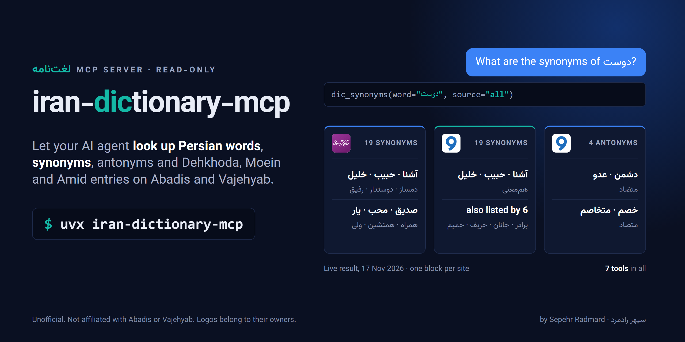

<!-- mcp-name: io.github.sepehr071/iran-dictionary-mcp -->

<div align="center">



# iran-dictionary-mcp: Persian dictionary (لغت‌نامه) MCP server for AI agents, Abadis + Vajehyab

**iran-dictionary-mcp is an unofficial, read-only MCP server that lets an AI agent look up Persian words, synonyms, antonyms and translations on two dictionary sites at once: Abadis (آبادیس, abadis.ir) and Vajehyab (واژه‌یاب, vajehyab.com).**<br>
Its 7 tools return Dehkhoda, Moein and Amid meanings, synonyms and antonyms, pure-Persian equivalents, English, Arabic and Turkish translation with example sentences, spelling autocomplete and Persian first names.<br>
No API key or account is needed; it works in Claude, Cursor, Copilot and any other MCP client.

[](https://pypi.org/project/iran-dictionary-mcp/)
[](https://pypi.org/project/iran-dictionary-mcp/)
[](https://github.com/sepehr071/iran-dictionary-mcp/actions/workflows/ci.yml)
[](https://github.com/sepehr071/iran-dictionary-mcp/blob/main/LICENSE)

[For AI agents](#for-ai-agents) · [Quick start](#quick-start) · [Tools](#tools) · [Limits](#limits) · [فارسی](#فارسی)

</div>

---

## For AI agents

- **What:** unofficial MCP server (model context protocol) for abadis.ir and vajehyab.com, merged: word meanings, synonyms and antonyms, translation, autocomplete, plus each site's own tools (Abadis first names, Vajehyab scoped search and full entries).
- **Install:** `uvx iran-dictionary-mcp` or `claude mcp add iran-dictionary -- uvx iran-dictionary-mcp`. Transport: stdio. Needs [uv](https://docs.astral.sh/uv/getting-started/installation/) (Python 3.10+).
- **Auth:** none. Optional `IRAN_DICTIONARY_MCP_PROXY` (one HTTP proxy URL) applies to both sites; system proxy settings are ignored.
- **Access:** read-only. It cannot log in or save words.
- **Tools:** 7, all prefixed `dic_`. Four merged tools take `source` (`all` default, `abadis`, `vajehyab`) and answer with one block per site; if one site fails its block holds an `error` and the other still answers. The other three are one site's own tools.
- **Use when:** the user asks what a Persian word means, wants synonyms, antonyms or a pure-Persian equivalent, a Persian-English, Arabic or Turkish translation, the right spelling, rhymes, or a Persian first name by meaning.
- **Output:** compact JSON, mostly Persian text. Meaning text is cut short by default; `full` returns more.

## Quick start

You need [uv](https://docs.astral.sh/uv/getting-started/installation/). No API key or account.

Claude Code:

```bash
claude mcp add iran-dictionary -- uvx iran-dictionary-mcp
```

Claude Desktop, Cursor, VS Code and other clients:

```json
{
  "mcpServers": {
    "iran-dictionary": { "command": "uvx", "args": ["iran-dictionary-mcp"] }
  }
}
```

Example prompts:

- "What does the Persian word سلام mean, according to Dehkhoda?"
- "Give me synonyms and antonyms of دوست."
- "Translate hello into Persian with example sentences."
- <span dir="rtl">نام دخترانهٔ ایرانی با معنی گل پیشنهاد بده.</span>
- <span dir="rtl">معنی واژهٔ «دمساز» در لغت‌نامه دهخدا چیست؟</span>

Real result (17 Nov 2026), `dic_synonyms(word="دوست")`: Abadis returns 19 synonyms (آشنا، حبیب، خلیل، دمساز، دوستدار، رفیق ...); Vajehyab returns the same 19, antonyms دشمن، عدو، خصم، متخاصم, and 6 entries that list دوست as their synonym (برادر، جانان، حریف، حمیم، حواری، مقترن).

## Tools

Merged (both sites, `source` argument):

| Tool | What it does |
|---|---|
| `dic_lookup` | Look a word up in the Persian dictionaries of Abadis and Vajehyab, one block per site. |
| `dic_synonyms` | Find synonyms, antonyms and pure-Persian equivalents (برابر پارسی) of a Persian word, one block per site. |
| `dic_translate` | Translate a single word or short phrase between Persian and English, Arabic or Turkish, one block per site. |
| `dic_suggest` | Complete the start of a word into dictionary headwords, one list per site; use it to find the exact spelling. |

Single site:

| Tool | What it does |
|---|---|
| `dic_abadis_names` | Search Abadis's Persian first-name list by name, gender, origin, theme or first letter. |
| `dic_vajehyab_search` | Search Vajehyab's dictionaries with a scope: exact entries, entries naming it a synonym or antonym, rhymes, sound-alikes. |
| `dic_vajehyab_entry` | Read one whole Vajehyab entry (for example the full Dehkhoda text with its poetry), cut at `max_chars`. |

## Limits

- Single words and short phrases, not sentences. `ar-fa` with Arabic-letter spellings (such as كتاب with an Arabic kaf) was not checked and may find nothing.
- Abadis has no Arabic or Turkish to Persian. Vajehyab's English translation is shorter than its site page, which adds a subscription source.
- There is no public proverb or poetry search; Dehkhoda entries quote poetry.
- Vajehyab engine excerpts are about 200 characters; use `dic_lookup(full=True)` or `dic_vajehyab_entry` for the whole entry.
- Dictionary text is third-party content. Both sites answer from outside Iran.

## How it works

Neither site has a public API. Abadis pages are fetched and parsed as HTML; Vajehyab is read through its own search engine JSON and the data embedded in its entry pages. The tools were mapped in Chrome and checked against the real pages on 2026-11-16 (meanings, 19 synonyms, antonyms, English translation with examples, first names). One mismatch found there (synonym lists that mention the word) is fixed in `dic_synonyms`.

## فارسی

<div dir="rtl">

iran-dictionary-mcp یک سرور MCP غیررسمی و فقط‌خواندنی است که معنی واژه‌ها، مترادف و متضاد، برابر پارسی، ترجمه به انگلیسی، عربی و ترکی و نام‌های ایرانی را هم‌زمان از دو سایت آبادیس و واژه‌یاب (شامل لغت‌نامه دهخدا، معین و عمید) برای عامل هوش مصنوعی می‌آورد. نصب در Claude Code:

</div>

```bash
claude mcp add iran-dictionary -- uvx iran-dictionary-mcp
```

## Development

```bash
uv sync
uv run ruff check . && uv run ruff format --check .
uv run pytest -q          # offline tests on recorded fixtures
uv run pytest -m live -q  # live calls to Abadis and Vajehyab
```

Releases: bump the version in `pyproject.toml` and `server.json`, run `uv lock`, then push a `v*` tag; GitHub Actions publishes to PyPI.

## Disclaimer

Unofficial and not affiliated with or endorsed by Abadis or Vajehyab. It is read-only and uses the public pages and endpoints of those sites, which can change without notice.

## Author

Built and maintained by **Sepehr Radmard** (سپهر رادمرد). [LinkedIn](https://www.linkedin.com/in/sepehr-radmard) · [GitHub](https://github.com/sepehr071) · more servers in [iran-mcp](https://github.com/sepehr071/iran-mcp).

## مجوز استفاده (License)

<a href="https://www.linkedin.com/in/sepehr-radmard"></a>

**استفادهٔ شخصی و غیرتجاری رایگان است.** استفاده در شرکت، محصول پولی یا پروژهٔ مشتری به مجوز تجاری نیاز دارد؛ از راه [لینکدین](https://www.linkedin.com/in/sepehr-radmard) یا [گیت&zwnj;هاب](https://github.com/sepehr071) با سپهر رادمرد تماس بگیرید. متن کامل: [PolyForm Noncommercial 1.0.0](https://github.com/sepehr071/iran-dictionary-mcp/blob/main/LICENSE). نسخه&zwnj;های پیش از 0.1.1 با مجوز MIT منتشر شده&zwnj;اند و همان مجوز را دارند.

Free for personal and non-commercial use under the [PolyForm Noncommercial License 1.0.0](https://github.com/sepehr071/iran-dictionary-mcp/blob/main/LICENSE). Using it in a company, a paid product or a client project needs a commercial license: contact Sepehr Radmard on [LinkedIn](https://www.linkedin.com/in/sepehr-radmard) or [GitHub](https://github.com/sepehr071). Versions before 0.1.1 were released under MIT and stay under it.
